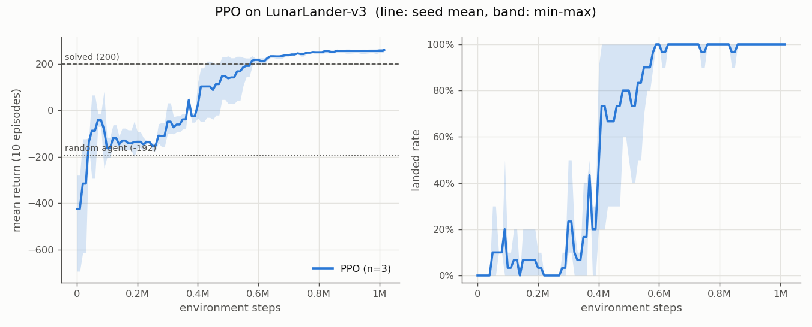
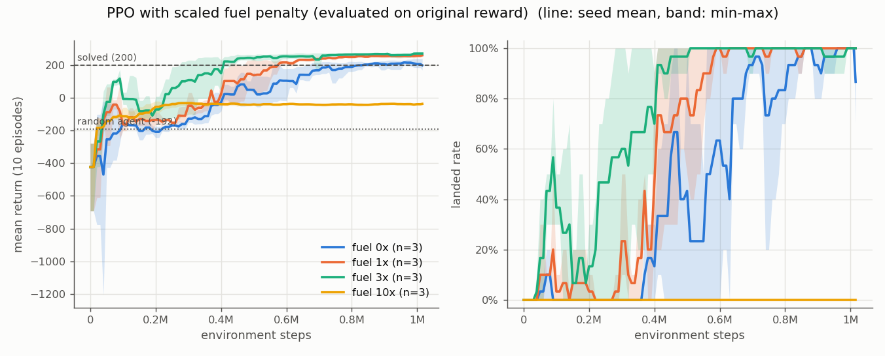

# Experiments

Honest log of every experiment: what was tried, the actual numbers, and what was learned.
Environment: `LunarLander-v3` (gymnasium 1.0.0). "Solved" threshold: mean return >= 200.

## 0. Setup notes

- Installing Box2D on Windows took three attempts (see README): swig had to be installed
  first, then `box2d-py` built with `--no-build-isolation`.
- The `constraints.txt` torch pin held: torch stayed at `2.6.0+cu124` with CUDA available.
- First parallel launch (3 PPO x 16 workers + 3 DQN) crashed: TensorFlow is installed and
  gets imported by every spawned worker via SB3 -> tensorboard. RAM ran out during
  imports, workers died, and the three PPO parent processes **hung silently** (alive, 0%
  progress, empty logs) - exactly the failure mode from the chess project, triggered by
  memory instead of sleep. Fixed by blocking the TensorFlow import (saves ~320 MB and ~4 s
  per process) and running PPO seeds one at a time.

## 1. Random agent baseline

`python -m scripts.random_baseline` - uniform random actions, 100 episodes (seeds 0-99).

| metric | value |
|---|---|
| mean return | **-192.1 +/- 114.4** (min -462.5, max 8.3) |
| outcome | crashed 100%, landed 0%, timeout 0% |
| episode length | 90 steps |
| engine use | main 22, side 45 steps per episode |

**Learned:** random play crashes within ~2 seconds of game time (50 fps). Every trained
agent has to be compared against -192, not against 0: a return of 0 is already a big
improvement over random.

## 2. PPO baseline

`experiments/ppo.txt` - SB3 PPO, RL Zoo hyperparameters (n_envs=16 SubprocVecEnv,
n_steps=1024, batch 64, n_epochs=4, gamma=0.999, gae_lambda=0.98, ent_coef=0.01),
1M steps (actually 1,015,808: rounded up to a multiple of 16,384), CPU, seeds 0-2.
Eval during training: every 10k steps, 10 deterministic episodes on fixed seeds.

**Speed.** PPO's 64x64 MLP is faster on CPU than on the GPU (65k steps: 0.4 min CPU vs
0.6 min GPU); moving one observation batch to the GPU per step costs more than the
tiny forward pass. Wall time per 1M-step run: 6.7 / 14.5 / 15.2 min (the later runs
shared the CPU with other jobs).

**Final models, 100 episodes each** (`results/ppo_final.json`, eval seeds 50000+):

| seed | mean return | min | landed | crashed | timeout | length | main / side engine steps |
|---|---|---|---|---|---|---|---|
| 0 | **262.7 +/- 20.1** | 214.7 | 100% | 0% | 0% | 277 | 130 / 91 |
| 1 | **243.3 +/- 25.7** | 118.5 | 98% | 0% | 2% | 387 | 188 / 104 |
| 2 | **258.8 +/- 20.4** | 212.3 | 100% | 0% | 0% | 320 | 154 / 33 |

All three seeds solve the task (>= 200). Seeds found different styles: seed 2 barely
uses the side engines, seed 1 uses them 3x as much and lands more slowly.

**Checkpoints of seed 0, 100 episodes each** (`results/ppo_s0_checkpoints.json`):

| step | mean return | landed | crashed | timeout | length | main engine steps |
|---|---|---|---|---|---|---|
| 10k | -310.6 | 0% | 100% | 0% | 139 | 80 |
| 50k | -7.9 | 4% | 64% | 32% | 473 | 190 |
| 100k | -174.4 | 1% | 93% | 6% | 550 | 313 |
| 250k | -149.1 | 0% | 97% | 3% | 469 | 267 |
| 500k | 79.5 | 63% | 28% | 9% | 592 | 280 |
| 1M | 262.7 | 100% | 0% | 0% | 277 | 130 |

**Learned:**
- The 10k checkpoint is *worse than random* (-311 vs -192). PPO's first update happens
  only after 16,384 steps, so this is the untrained network; run deterministically it
  keeps picking nearly the same action (main engine) and flies off-screen. Random
  actions at least cancel out.
- Learning is not monotonic. At 50k the agent has learned to hover (32% timeouts, return
  -8). Between 100k and 250k the return drops back to about -150 to -175 and nearly every
  episode crashes after ~500 steps. My reading (not verified): it has started trying to
  descend but cannot yet land softly. Hovering is a local optimum. A plot of the return
  alone would suggest 50k is "better" than 250k, but it is a dead end.
- The final agent is not only higher-scoring but more efficient: episodes are half as
  long as at 500k and main-engine use drops from 280 to 130 steps. The fuel penalty
  keeps pushing it toward short, decisive landings once landing itself is solved.
- The remaining failure mode at 1M is still hovering (seed 1: 2 timeouts out of 100), not
  crashing.

Video: `videos/ppo_progress.mp4` (10k / 50k / 250k / 500k / 1M on seeds 0-2).

## 3. DQN vs PPO (off-policy vs on-policy)

`experiments/dqn.txt` - SB3 DQN, RL Zoo hyperparameters (single env, buffer 50k,
batch 128, lr 6.3e-4, train_freq 4, gradient_steps -1, target update every 250 steps,
epsilon 1 -> 0.1 over the first 12% of training, MLP 256x256), 1M steps, GPU, seeds 0-2.
Same evaluation protocol as PPO.

**Final models, 100 episodes each** (`results/dqn_final.json`):

| seed | mean return | landed | crashed | timeout | length | main / side engine steps |
|---|---|---|---|---|---|---|
| 0 | -174.1 +/- 157.4 | 8% | 77% | 15% | 351 | 165 / 144 |
| 1 | -562.8 +/- 146.6 | 0% | 100% | 0% | 67 | **0** / 66 |
| 2 | 150.4 +/- 87.1 | 25% | 4% | 71% | 813 | 172 / 313 |

None of the final DQN models solves the task. Mean over seeds: **-195.5**, i.e. no
better than the random agent.

**Milestone checkpoints, mean return over 100 episodes**
(`results/dqn_final.json`, `results/dqn_s12_checkpoints.json`, `results/ppo_s0_checkpoints.json`):

| step | DQN s0 | DQN s1 | DQN s2 | PPO s0 |
|---|---|---|---|---|
| 50k | -225.1 | -213.7 | -176.9 | -7.9 |
| 100k | 188.9 | 61.5 | 152.5 | -174.4 |
| 250k | 220.1 | 188.5 | 219.6 | -149.1 |
| 500k | **258.3** (96% landed) | 97.3 | **-1078.7** | 79.5 |
| 1M | -174.1 | -562.8 | 150.4 | 262.7 |

**Wall time:** PPO 1M steps = 7-15 min on CPU; DQN 1M steps = ~129 min each (3 runs in
parallel on one GPU, sharing the CPU with PPO jobs). DQN does one gradient step per
environment step; PPO collects 16k steps with 16 parallel envs, then does 4 epochs.

**Learned:**
- **Sample efficiency (off-policy wins early):** at 100k-250k steps DQN is already at
  +150 to +220 while PPO is still at about -150. DQN keeps every transition in a replay
  buffer and reuses it many times; PPO uses each rollout for 4 epochs and then throws it
  away, because its update is only valid for data from the current policy.
- **Stability (on-policy wins late):** every DQN seed later collapsed. Seed 2 went
  from +220 at 250k to -1079 at 500k (worst episode -3466: burning the engines until a
  crash). Seed 1 ended up never firing the main engine at all. DQN bootstraps: its target
  values come from its own (target) network, so errors can feed on themselves. PPO's
  clipped update limits how far the policy moves per update; none of its 3 seeds ever
  lost what it had learned.
- **Practical consequence:** with DQN, "train N steps and take the last model" is a bad
  protocol. You would keep the best checkpoint by evaluation score (SB3
  `EvalCallback(best_model_save_path=...)`), and/or use a lower learning rate, a larger
  buffer, or Double/Dueling DQN. I did not try those here; the point of this experiment
  was the default comparison.
- **Reproducibility:** with identical hyperparameters, DQN seeds ended at -563, -174 and
  +150. A single-seed DQN experiment could have said anything.

Video: `videos/ppo_vs_dqn.mp4` (PPO 1M, DQN s0 at its 500k peak, DQN s0 1M, DQN s1 1M).

## 4. Reward shaping: scaling the fuel penalty

`experiments/fuel.txt` - PPO, same settings as experiment 2, with `FuelCostWrapper`
multiplying the per-frame fuel penalty (main 0.3, side 0.03) by 0, 3 or 10 for both
engines. 1x is the PPO baseline. **All evaluation uses the original reward**, so the
numbers are directly comparable. Seeds 0-2.

**Final models, 100 episodes each** (`results/fuel_s01.json`, `results/fuel_s2.json`,
`results/ppo_final.json`):

| fuel cost | return per seed | mean | landed | timeout | length | main / side engine steps |
|---|---|---|---|---|---|---|
| 0x (free) | 189.7 / 238.3 / 190.6 | **206.2** | 97 / 100 / 90% | 2 / 0 / 10% | 644 / 414 / 648 | ~290 / ~210 |
| 1x (original) | 262.7 / 243.3 / 258.8 | **254.9** | 100 / 98 / 100% | 0 / 2 / 0% | 277 / 387 / 320 | ~157 / ~76 |
| 3x | 266.6 / 269.9 / 267.2 | **267.9** | 100 / 100 / 99% | 0 / 0 / 1% | 266 / 262 / 260 | ~118 / ~35 |
| 10x | -22.9 / -38.7 / -37.4 | **-33.0** | 0 / 0 / 0% | 0% (100% crashed) | 84 / 75 / 76 | ~26 / ~4 |

(engine steps are means over the three seeds)

**Learned:**
- **10x: the agent deliberately crashes**, in all three seeds. With the main engine costing
  3.0 per frame, a soft landing (~120 frames of main engine, about -360) is worse than
  a crash (-100). The agent fires the engine ~25 frames to slow down a bit and then crashes
  in ~80 steps. That is the optimal policy *for the reward it was given*. The agent
  optimizes what is rewarded, not what was meant.
- **0x: free fuel makes the agent slow and hover-prone.** Episodes are 2x longer, engine use
  roughly doubles, and up to 10% of episodes time out hovering. Return on the original
  reward drops to 206 (above 200 on average, but only 1 of 3 seeds is above 200), mostly because the agent wastes fuel
  that the original reward charges for.
- **3x was better than the original reward, even when scored with the original reward**
  (267.9 vs 254.9, all three 3x seeds above all three 1x seeds) and **it learned
  fastest** (crosses 200 at ~0.4M steps vs ~0.6M for 1x and ~0.8M for 0x in the eval
  curves). My interpretation: expensive fuel makes hovering expensive, so the agent leaves
  the hovering local optimum sooner, and a frugal policy also scores higher on the
  original reward, which charges for fuel too. There is a threshold between 3x and 10x
  beyond which the incentive flips from "land efficiently" to "crash cheaply". I did not
  search for it.
- Shaping is a double-edged tool. The same knob (fuel price) produced the best agent at
  3x and a suicidal one at 10x.

Video: `videos/fuel_shaping.mp4` (0x / 1x / 3x / 10x side by side, seeds 0-2).

## Summary

| agent | mean return (100 episodes, mean over 3 seeds) | solved seeds |
|---|---|---|
| random | -192.1 | - |
| PPO, 1M steps | 254.9 | 3 / 3 |
| DQN, 1M steps (final model) | -195.5 | 0 / 3 |
| DQN, best milestone per seed | 258.3 / 188.5 / 219.6 | 2 / 3 |
| PPO, fuel 0x | 206.2 | 1 / 3 |
| PPO, fuel 3x | 267.9 | 3 / 3 |
| PPO, fuel 10x | -33.0 | 0 / 3 |

Takeaways for the air-hockey project:
1. Log behaviour, not just return. Outcome rates (landed / crashed / timeout), episode
   length and action usage explained every surprising number here.
2. Use 3+ seeds. DQN seeds ranged from -563 to +150 with identical settings.
3. Keep the best checkpoint, not only the last, especially with off-policy methods.
4. Every reward term is an incentive the agent *will* exploit. Check the cheapest way to
   collect or avoid each term (e.g. "crash instead of paying for fuel") before training.
5. On Windows, budget memory for SubprocVecEnv workers (each is a full Python + torch
   process), and treat a silent, idle training process as hung, not slow.
