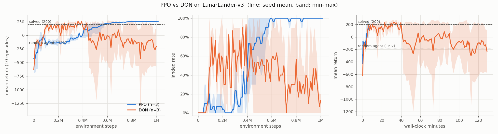

# LunarLander RL warm-up

A small, fast-feedback reinforcement learning project: train an agent to land the
Gymnasium `LunarLander-v3` rocket softly, compare PPO (on-policy) with DQN (off-policy),
and study the effect of reward shaping. Results are logged in [EXPERIMENTS.md](EXPERIMENTS.md).

## Results

Full write-up with all numbers: [EXPERIMENTS.md](EXPERIMENTS.md). Mean return over 100
evaluation episodes, averaged over 3 seeds (solved = 200):

| agent | mean return | seeds >= 200 |
|---|---|---|
| random | -192.1 | - |
| PPO, 1M steps | **254.9** | 3 / 3 |
| DQN, 1M steps (final model) | -195.5 | 0 / 3 (all three collapsed after peaking at 189-258) |
| PPO, fuel penalty 0x / 3x / 10x | 206.2 / **267.9** / -33.0 | 1 / 3 / 0 of 3 |



## Setup (Windows, Python 3.11)

Tested with Python 3.11, gymnasium 1.0.0, stable-baselines3 2.8.0, torch 2.6.0+cu124.

### 1. Protect the CUDA build of torch

pip sometimes replaces a CUDA torch build with the CPU wheel when resolving another
package's dependencies. Every install below uses `constraints.txt`, which pins the exact
torch build, so pip fails loudly instead of swapping it. Check after installing:

```powershell
python -c "import torch; print(torch.__version__, torch.cuda.is_available())"
```

### 2. Box2D on Windows

`gymnasium[box2d]` depends on `box2d-py==2.3.5`, which has no Windows wheel and is compiled
from source. It needs SWIG and the MSVC C++ build tools (Visual Studio "Desktop development
with C++" workload). A plain `pip install "gymnasium[box2d]"` fails in two ways:

1. `error: command 'swig.exe' failed: None`: swig is not installed yet. pip installs
   everything in one transaction, so swig from the same command is not available while
   box2d-py builds.
2. `ModuleNotFoundError: No module named 'swig'` from `swig.exe`: pip builds in an isolated
   environment, where the `swig.exe` launcher cannot find the `swig` Python package.

Working sequence:

```powershell
python -m pip install -c constraints.txt swig
python -m pip install -c constraints.txt --no-build-isolation box2d-py==2.3.5
python -m pip install -c constraints.txt "gymnasium[box2d]==1.0.0" stable-baselines3 matplotlib "imageio[ffmpeg]"
python -m pip install -c constraints.txt pytest black ruff
```

Verify:

```powershell
python -c "import gymnasium as gym; gym.make('LunarLander-v3').reset(seed=0); print('ok')"
```

## Project layout

```
lunar/          library code
  envs.py         env factories (Monitor sits *inside* reward shaping, so logs show the original return)
  wrappers.py     FuelCostWrapper: rescales the fuel penalty for reward-shaping experiments
  evaluation.py   episode rollouts that also record the outcome (landed / crashed / timeout) and fuel use
  callbacks.py    periodic evaluation to eval.csv, milestone + rolling checkpoints
  training.py     hyperparameters, train / resume, model loading
  power.py        blocks Windows idle sleep during training
scripts/        command-line entry points (run with python -m scripts.<name>)
experiments/    job files and a PowerShell launcher for the experiment runs
tests/          pytest suite
figures/        generated plots (committed)
results/        100-episode evaluation summaries as JSON (committed)
runs/, videos/  training artifacts (git-ignored)
```

## Usage

All commands run from the project root.

```powershell
# Random-agent baseline (100 episodes)
python -m scripts.random_baseline

# Train. --timesteps is the absolute total; --resume continues from checkpoints/latest.zip
python -m scripts.train --algo ppo --seed 0 --timesteps 1000000
python -m scripts.train --algo dqn --seed 0 --timesteps 1000000 --device cuda
python -m scripts.train --algo ppo --fuel-main-scale 0 --fuel-side-scale 0 --run-name ppo_fuel0_s0
python -m scripts.train --algo ppo --seed 0 --timesteps 1500000 --resume

# Run a whole experiment (one job per line, logs in runs/logs/)
powershell -File experiments/run_parallel.ps1 experiments/ppo.txt -MaxParallel 1

# Evaluate over 100 episodes (original reward)
python -m scripts.evaluate runs/ppo_s0 runs/dqn_s0

# Plot curves (seed mean + min-max band)
python -m scripts.plot --group "PPO=runs/ppo_s*" --group "DQN=runs/dqn_s*" --out figures/ppo_vs_dqn.png --wall-time

# Watch live
python -m scripts.watch runs/ppo_s0
python -m scripts.watch runs/ppo_s0/checkpoints/step_100000.zip --episodes 3

# Side-by-side video of checkpoints on the same seeds
python -m scripts.record --model "10k=runs/ppo_s0/checkpoints/step_10000.zip" --model "final=runs/ppo_s0" --seeds 0 1 2 --out videos/ppo_progress.mp4

# Tests and formatting
python -m pytest
python -m black lunar scripts tests
python -m ruff check lunar scripts tests
```

Each run directory contains `config.json`, `eval.csv` (one row per evaluation:
return, landed/crashed/timeout rates, fuel use, wall time), `sb3_log/progress.csv`
(SB3 internals such as entropy and value loss) and `checkpoints/`
(`step_<N>.zip` milestones, `latest.zip` for resuming, `final.zip`).

## Windows pitfalls hit in this project

- **SubprocVecEnv + TensorFlow installed:** on Windows every env worker is a fresh
  `spawn`ed Python process that re-imports SB3, and SB3's logger pulls in TensorFlow via
  tensorboard (~320 MB, ~4 s per process). Starting 48 workers at once ran out of RAM; some
  workers died mid-import (`partially initialized module 'pandas'`), and their parent
  processes **hung forever** waiting on the dead workers instead of exiting.
  `lunar/__init__.py` marks TensorFlow as unavailable for this project's processes, and
  PPO runs (16 workers each) are launched one at a time.
- **Sleep:** `lunar/power.py` holds `ES_SYSTEM_REQUIRED` during training. This blocks idle
  sleep only; closing the laptop lid still suspends the machine.
- **Non-ASCII path (`Masaüstü`):** TensorBoard is not used; logs are plain CSV. Console
  output is ASCII-only.
- **Resume semantics:** SB3's `learn(total_timesteps=n, reset_num_timesteps=False)` trains
  `n` *more* steps. `scripts/train.py` treats `--timesteps` as the absolute target and passes
  the difference (tested in `tests/test_training.py`).
- **PPO step counts round up** to a multiple of `n_steps * n_envs` (1024 x 16 = 16,384), so a
  "1M step" PPO run actually trains 1,015,808 steps.
